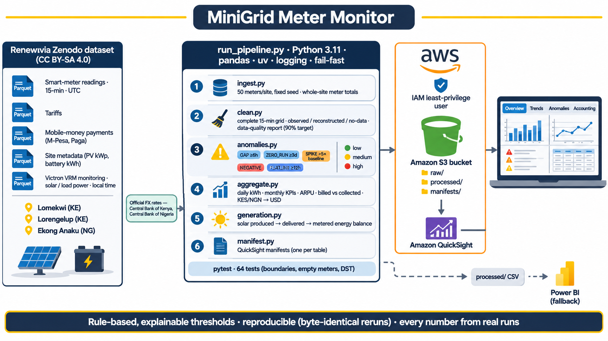
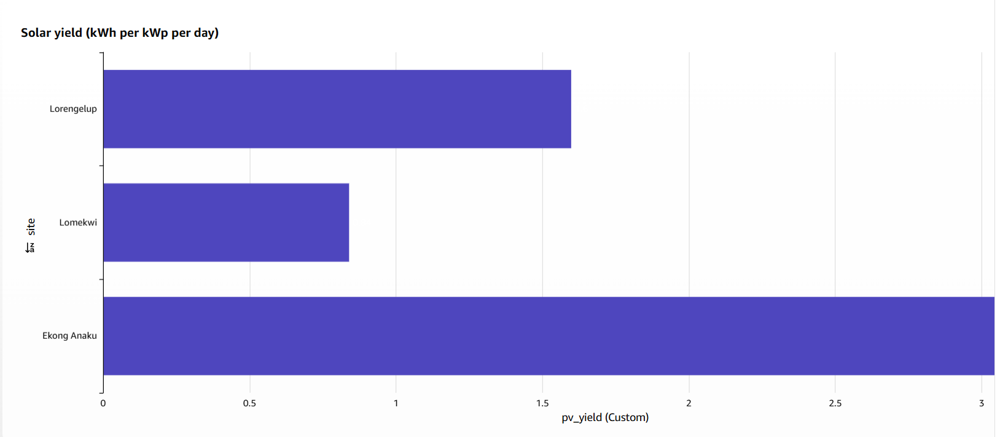
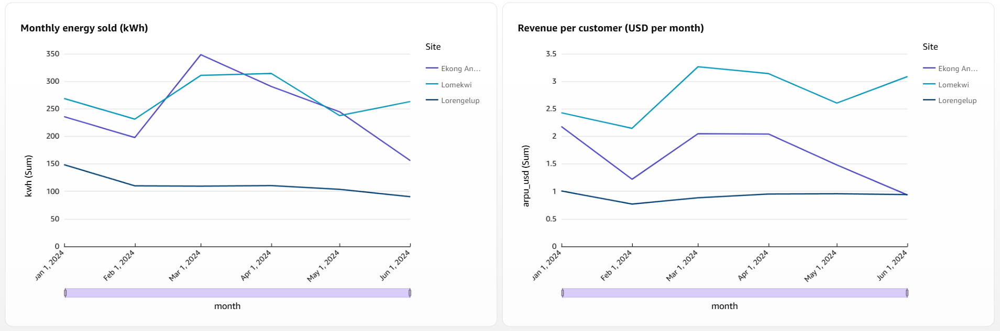
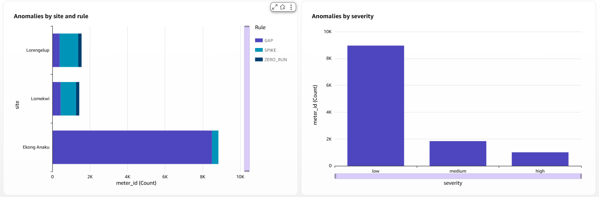

# MiniGrid Meter Monitor

An end-to-end data pipeline and dashboard for community solar mini-grids. It turns raw 15-minute smart-meter
readings, payments and solar-system monitoring into data-quality reports, rule-based anomaly alerts, revenue
accounting and an energy balance, published to AWS S3 and visualised in Amazon QuickSight.

Built on six months of real operational data (January–June 2024) from three Renewvia mini-grids in Kenya and
Nigeria.



## Key results

Scope: 2 January – 30 June 2024 (181 full local days). Consumption and revenue cover a reproducible random
sample of 50 customers per site; the energy balance uses every meter at each site. All figures come from
pipeline runs and are traceable to the output tables.

| Site | Country | Energy sold | Billed | Collected | Collected ÷ billed | Metered ÷ delivered energy |
|---|---|---|---|---|---|---|
| Lomekwi | Kenya | 1,625.6 kWh | KES 96,173 (USD 692) | KES 99,003 (USD 712) | 102.9% | 74.9% |
| Ekong Anaku | Nigeria | 1,472.9 kWh | NGN 588,851 (USD 449) | NGN 586,762 (USD 446) | 99.6% | 84.2% |
| Lorengelup | Kenya | 672.7 kWh | KES 33,554 (USD 238) | KES 32,268 (USD 230) | 96.2% | 39.3% |
| **Total** | | **3,771.2 kWh** | **USD 1,379** | **USD 1,388** | **100.6%** | |

**Findings**

1. **Billing reconciles with cash.** Mobile-money payments are within 4% of estimated billing at every site.
   This independently validates the tariff lookup and the use of the dataset's reconstructed readings for
   revenue: on observed readings alone, Ekong Anaku's billing would cover only about 61% of what customers paid.
2. **Lorengelup loses most of its energy before the meter.** Only 39% of the energy its power system delivers
   is recorded by customer meters (987 kWh unmetered against 640 kWh metered on monitored days). Its meter data
   is 99% observed, so this is not a data gap. The unmetered load runs at every hour, about 150 W by day and
   330–400 W at night, which points to an unmetered constant or night-time load such as street lighting. It
   needs verification on site.
3. **Low solar yield in Kenya reflects low demand, not poor solar.** Lomekwi produces 0.84 kWh per kWp per day
   with its battery 92% charged on average: panels are curtailed because the battery is full. Ekong Anaku
   reaches 3.19 kWh/kWp/day at 46% average charge. Lomekwi has spare capacity for new connections or
   productive-use customers.
4. **Currency risk dominates Nigerian revenue in dollars.** The naira lost about 40% against the dollar over
   the period. Ekong Anaku's revenue fell 16% in naira from January to February, but about 48% in dollars.
5. **Customer mix shapes the load.** Lomekwi and Ekong Anaku peak in the evening (19:00 and 20:00 local time).
   Lorengelup peaks at 10:00, because its commercial customers out-consume its residential customers every month.
6. **Data quality varies sharply by site.** Median observed-data share is 94.7% at Lorengelup, 82.8% at Lomekwi
   and 8.3% at Ekong Anaku, where most readings are reconstructed by the data provider. This explains Ekong
   Anaku's 8,496 GAP events, and is why its anomaly counts are not compared directly with the Kenyan sites.

## Dashboard (Amazon QuickSight)

Four sheets, built from the S3 tables through one QuickSight manifest per table. Every number shown was checked
against the pipeline output files.

**Overview**: energy sold, billing and collection in USD, metered share of delivered energy, and solar yield.




**Trends**: monthly energy and revenue per customer, daily energy, and the average day per site.




**Anomalies and data quality**: rule-based anomalies and the observed-data share per meter.




**Accounting**: revenue and VAT by site, month and tariff class, with the exchange rates applied.


## How it works

| Step | Module | What it does |
|---|---|---|
| Ingest | `ingest.py` | Reads the source Parquet files for the analysis window, draws a seeded random sample of 50 meters per site, and extracts tariffs, payments, site facts and solar-system monitoring. |
| Clean | `clean.py` | Validates timestamps and values, builds a complete 15-minute grid per meter, labels every slot as observed, reconstructed or missing, and writes a per-meter data-quality report. |
| Anomalies | `anomalies.py` | Applies five explainable rules to observed readings and ranks each event by severity. |
| Aggregate | `aggregate.py` | Daily and monthly energy per meter and site, the tariff in force on each day, billed revenue with and without VAT, collections, ARPU, hourly load profile, and USD conversion. |
| Energy balance | `generation.py` | Converts monitoring power readings into 15-minute energy, then compares solar generation, energy delivered and energy metered over the same monitored time slots. |
| Manifests | `manifest.py` | Writes one QuickSight S3 manifest per dashboard table. |

`run_pipeline.py` runs all steps in order. It logs to the console and to a per-run file, and stops at the first
failure with a non-zero exit code, so downstream tables are never rebuilt from stale inputs. `storage.py` is the
single point that decides whether files are read and written locally or on S3.

### Anomaly rules

All thresholds are explicit business rules; no machine learning is used. Results for 150 meters:

| Rule | Flags | Severity | Events |
|---|---|---|---|
| GAP | No observed reading for 6 h or more | Low ≤ 24 h, Medium ≤ 72 h, High > 72 h | 9,318 |
| SPIKE | Reading above 5 × the customer's typical in-use level over the previous 7 days | Low ≤ 10×, Medium ≤ 20×, High > 20× | 2,157 |
| ZERO_RUN | Zero consumption for 3 days or more | Medium ≤ 7 days, High > 7 days | 346 |
| NEGATIVE | Any reading below zero | Always high | 0 |
| FLATLINE | The same non-zero value for 12 h or more | Low ≤ 24 h, Medium ≤ 48 h, High > 48 h | 0 |

The SPIKE baseline was calibrated on the data: 75% of observed readings are zero, so a plain 7-day median would
be zero and flag any use at all. The baseline is therefore the median of non-zero readings, with a floor and a
minimum history. NEGATIVE and FLATLINE found no events in this sample and remain as safeguards.

### Engineering practices

- **Reproducible:** a fixed random seed selects the same meters on every run, and a full rerun rebuilt every
  processed file byte-for-byte identical.
- **Tested:** 64 pytest tests cover each anomaly rule, the aggregation and tariff logic, the energy balance and
  the manifests.
- **Secure cloud access:** a dedicated private S3 bucket, accessed by an IAM user whose policy allows only
  list, read and write on that bucket ([`docs/aws/iam_policy_pipeline.json`](docs/aws/iam_policy_pipeline.json)).
  Credentials live outside the repository.
- **Robust on constrained hardware and networks:** column-selective Parquet reads cut the memory needed to load
  the monitoring data from over 2 GB to about 0.75 GB, and S3 transfers use longer timeouts, retries and limited
  parallelism for slow connections.
- **Documented:** every threshold, assumption and deviation from the original specification is recorded with
  its reason.

## Running the pipeline

Requires [uv](https://docs.astral.sh/uv/) (Python 3.11 is installed automatically).

```bash
uv sync                          # create the environment from the lock file
cp .env.example .env             # S3 bucket, AWS profile and region (only needed for S3 mode)

uv run python run_pipeline.py --local                # full pipeline, local files only
uv run python run_pipeline.py --local --skip-ingest  # reuse data/raw/ without the source files
uv run python run_pipeline.py                        # read and write the S3 bucket named in .env
uv run pytest -q                                     # 64 tests
```

A full local run takes about 2–3 minutes. Outputs are written to `data/raw/` and `data/processed/`, and to the
same paths in the S3 bucket when `--local` is omitted.

**Source data.** Raw data is not included in this repository. Download the following files from the
[Renewvia dataset on Zenodo](https://zenodo.org/records/22149102) into `data/source/renewvia/`:
`sparkmeterreadings_clean_Lomekwi.parquet`, `sparkmeterreadings_clean_Lorengelup.parquet`,
`sparkmeterreadings_clean_Ekong_Anaku.parquet`, `minigridprojects.parquet`, `tariffs.parquet`,
`paymentconfirmations.parquet` and `vrmgeneration.parquet`.

## Repository layout

```
run_pipeline.py        pipeline runner (logging, fail-fast)
config.py              paths, analysis window, sites, thresholds
storage.py             local / S3 read and write
ingest.py clean.py anomalies.py aggregate.py generation.py manifest.py   pipeline steps
tests/                 unit tests
reference/             official monthly USD exchange rates (Central Bank of Kenya, Central Bank of Nigeria)
docs/                  decisions log, data and metrics guide, IAM policy, images
```

## Limitations

- **Sample, not census.** Consumption and revenue cover 50 customers per site (26%, 77% and 81% of meters at
  Ekong Anaku, Lomekwi and Lorengelup). The energy balance uses all meters.
- **Estimated generation.** Monitoring reports instantaneous power, so energy is approximated from 15-minute
  averages. Only days with at least 90% monitoring coverage are included.
- **Ekong Anaku data quality.** Most readings are reconstructed by the data provider, so its hourly profile and
  anomaly counts are less reliable than those of the Kenyan sites.
- **Collections cover mobile money only.** Cash top-ups, if any, are not in the payment data.
- **Six months.** The period is too short to show seasonal patterns.

## What I would do with an operator's own data

- **Run it on a schedule** (for example AWS Lambda or a cron job) with incremental loads, and send high-severity
  anomalies to field teams by SMS or email instead of waiting for someone to open a dashboard.
- **Reconcile metering with the billing system** directly, rather than estimating billed revenue from kWh and
  tariffs, to separate unpaid consumption from metering faults.
- **Investigate unmetered energy site by site.** Lorengelup's 61% gap would justify a network audit; the same
  balance check can rank every site by recoverable energy.
- **Tune thresholds with field feedback.** Record which alerts were real faults, tampering or false alarms, and
  adjust thresholds per customer class before considering any statistical model.
- **Use the demand data for planning:** identify sites with spare capacity, such as Lomekwi, for new
  connections and productive-use customers, and size storage from the observed evening peaks.

## Documentation

- [`docs/data_and_metrics.md`](docs/data_and_metrics.md): the data, metrics and methods, for a non-technical reader.
- [`docs/decisions.md`](docs/decisions.md): every design decision, threshold and deviation from the original
  specification, with its reason.

## Data sources and licence

- **Renewvia mini-grid dataset** (core pipeline): Selby, N. (2026). *High-Frequency, Multi-Domain Operational
  Dataset for Community Solar Mini-Grids in Kenya and Nigeria* (Version 1.0) [Dataset]. Zenodo,
  https://zenodo.org/records/22149102. Licensed CC BY-SA 4.0; outputs derived from it are shared under the same
  licence.
- **Exchange rates:** Central Bank of Kenya monthly averages and Central Bank of Nigeria daily central rates,
  averaged per month (sources listed in `reference/usd_exchange_rates_2024h1.csv`).
- **KIT microgrid dataset** (planned DR Congo case study): Luh et al. (2022). *High-resolution real-world
  electricity data from three microgrids in the global south*. KIT RADAR, https://doi.org/10.35097/1305.
  Licensed CC BY 4.0.
