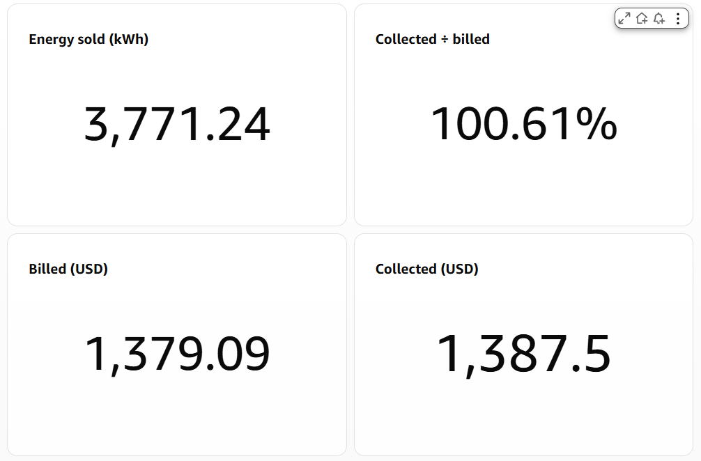
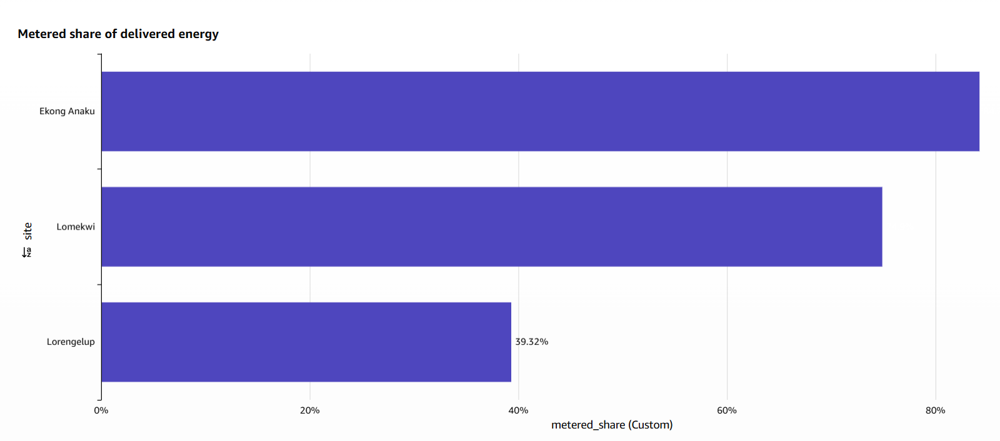
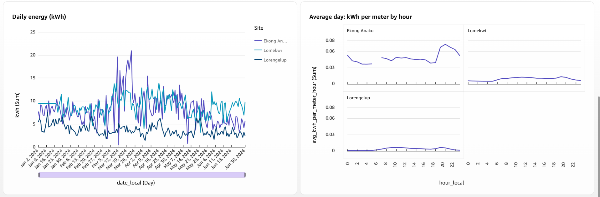
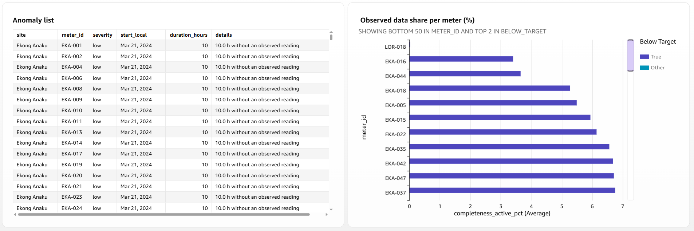
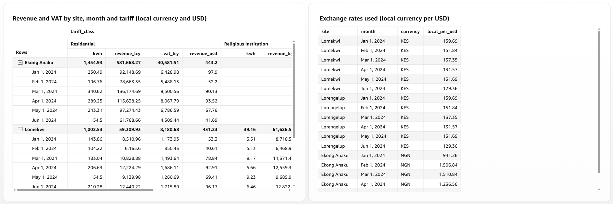

# MiniGrid Meter Monitor

A smart-meter data pipeline and dashboard for community solar mini-grids:
ingest → clean → rule-based anomaly detection → aggregation and revenue accounting → AWS S3 → QuickSight / Power BI.


> Work in progress: this README will be completed with real results from pipeline runs.

## How to run

```bash
uv run python run_pipeline.py --local                # full pipeline, local files only
uv run python run_pipeline.py --local --skip-ingest  # reuse data/raw/ (no source files needed)
uv run pytest -q                                     # 64 tests
```

Without `--local`, every step reads its inputs from and writes its outputs to the S3 bucket named in `.env`
(a dedicated bucket, accessed by an IAM user limited to that bucket: [`docs/aws/iam_policy_pipeline.json`](docs/aws/iam_policy_pipeline.json)).

## Dashboard (Amazon QuickSight)

Built from the S3 tables through one QuickSight manifest per table (`processed/manifests/`).
Every number shown was checked against the pipeline output files. Period: 2 Jan – 30 Jun 2024, 50-meter sample per site.

**Overview**: energy sold, billing and collection (USD), metered share of delivered energy, and solar yield.





**Trends**: monthly energy and revenue per customer, daily energy, and the average day per site.




**Anomalies and data quality**: rule-based anomalies (gaps, spikes, zero runs) and the observed-data share per meter.




**Accounting**: revenue and VAT by site, month and tariff class, with the exchange rates used.



Design decisions and every deviation from the original spec: [`docs/decisions.md`](docs/decisions.md).
Plain-language guide to the data and metrics: [`docs/data_and_metrics.md`](docs/data_and_metrics.md).

## Setup

Requires [uv](https://docs.astral.sh/uv/).

```bash
uv sync                 # creates .venv with Python 3.11 and installs locked dependencies
cp .env.example .env    # then fill in your bucket and AWS profile
```

## Data sources

- **Renewvia mini-grid dataset** (core pipeline): Selby, N. (2026). *High-Frequency, Multi-Domain Operational Dataset for Community Solar Mini-Grids in Kenya and Nigeria* (Version 1.0) [Dataset]. Zenodo, https://zenodo.org/records/22149102. Licensed CC BY-SA 4.0; processed outputs derived from it are shared under the same licence.
- **KIT microgrid dataset** (DR Congo case study): Luh et al. (2022). *High-resolution real-world electricity data from three microgrids in the global south*. KIT RADAR, https://doi.org/10.35097/1305. Licensed CC BY 4.0.

Raw data is not included in this repository; see the download instructions (coming in `docs/`).
